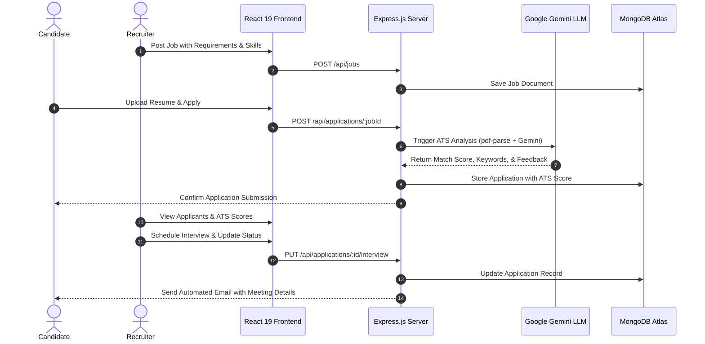
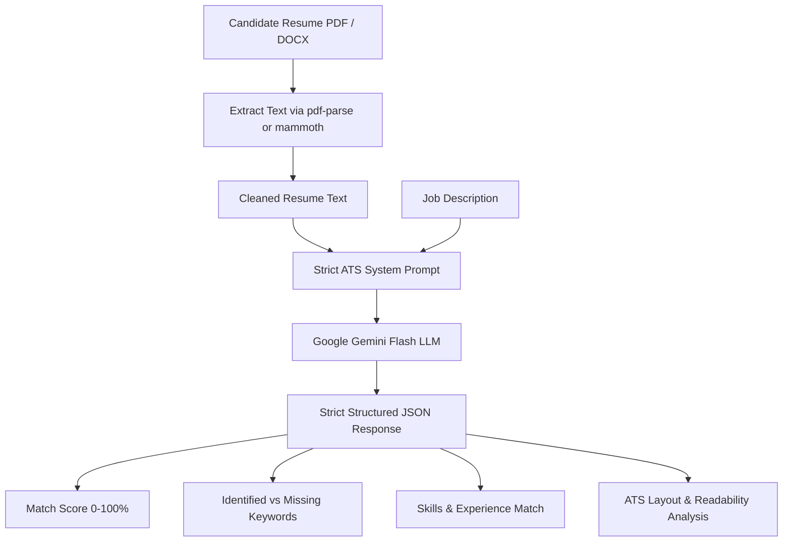

# CAREER CONNECT PORTAL (CCP)
## Comprehensive Technical Project Report
**Academic Year / Semester:** Final Year B.Tech / Semester 7 Capstone Project  
**Domain:** Full-Stack Web Development, Artificial Intelligence & Cloud Services  
**Technology Stack:** MERN Stack (MongoDB, Express.js, React 19, Node.js), Google Gemini AI, Cloudinary, Tailwind CSS v4  

---

## Table of Contents
1. [Executive Summary & Abstract](#1-executive-summary--abstract)
2. [Problem Statement & Project Objectives](#2-problem-statement--project-objectives)
3. [System Architecture & Design](#3-system-architecture--design)
4. [Technology Stack & System Dependencies](#4-technology-stack--system-dependencies)
5. [Role-Based Functional Modules](#5-role-based-functional-modules)
   - 5.1 [Job Seeker Module (Freshers & Experienced)](#51-job-seeker-module)
   - 5.2 [Employer & Recruiter Module](#52-employer--recruiter-module)
   - 5.3 [System Administrator Module](#53-system-administrator-module)
6. [Specialized AI Subsystems](#6-specialized-ai-subsystems)
   - 6.1 [AI ATS Resume Analyzer](#61-ai-ats-resume-analyzer)
   - 6.2 [AI Dynamic Career Roadmap Generator](#62-ai-dynamic-career-roadmap-generator)
   - 6.3 [Automated Corporate CIN & KYC Verification](#63-automated-corporate-cin--kyc-verification)
7. [Database Architecture & Data Models](#7-database-architecture--data-models)
8. [REST API Design & Endpoints Specification](#8-rest-api-design--endpoints-specification)
9. [UI/UX Architecture & Resume Builder](#9-uiux-architecture--resume-builder)
10. [Security, Authentication & Cloud Storage](#10-security-authentication--cloud-storage)
11. [Installation, Configuration & Execution Guide](#11-installation-configuration--execution-guide)
12. [Future Enhancements & Conclusion](#12-future-enhancements--conclusion)

---

## 1. Executive Summary & Abstract

The **Career Connect Portal (CCP)** is a comprehensive, AI-augmented talent acquisition and professional development ecosystem. Modern recruitment pipelines suffer from substantial friction: candidates send resumes into "black holes" without actionable feedback; freshers lack clear, guided pathways to bridge their skill gaps; recruiters receive thousands of unstructured, non-standardized resumes; and fraudulent companies pose security and financial risks to job applicants.

CCP resolves these industry pain points by pairing a **MERN Stack (MongoDB, Express.js, React 19, Node.js)** architecture with **Google Gemini Large Language Models (LLMs)**. The system offers:
- **Intelligent ATS Resume Evaluation**: Immediate keyword matching, scoring, and formatting recommendations against real job descriptions.
- **Dynamic Personalized Learning Roadmaps**: 12-week custom learning curricula, daily goals, tiered projects, and interview questions built from a candidate's profile and target dream role.
- **Corporate KYC & CIN Verification**: Cross-referencing Indian Corporate Identification Numbers (CIN) against government registry data with AI fallback to filter out fake recruiters.
- **Interactive Multi-Template Resume Builder**: An in-browser resume creator providing 5 professional layouts (Classic, Modern, Tech, Corporate, and Creative).
- **Full-Lifecycle Recruiter Workspace**: Complete tracking from application submission, through review, private notes, ratings, and integrated interview scheduling.

---

## 2. Problem Statement & Project Objectives

### 2.1 Problem Statement
1. **The Resume Black Hole**: Standard job portals act as passive aggregators where candidates rarely understand why their resumes fail to pass automated ATS filters.
2. **Ambiguity in Career Upskilling**: Job seekers who are rejected or seek higher-paying roles lack personalized, structured guidance tailored to their current skill deficits.
3. **Recruiter Credibility & Fraud**: Rising instances of shell companies posting scam job openings to harvest candidate personal data or solicit training fees.
4. **Disjointed Hiring Workflows**: Employers juggle disparate tools for resume screening, interview scheduling, note-taking, and candidate communication.

### 2.2 Project Objectives
- **Automate Screening**: Implement an AI ATS evaluation engine to parse `.pdf` and `.docx` resumes and measure alignment against job requirements.
- **Deliver Actionable Upskilling**: Create an AI mentor that maps candidate profiles to career roadmaps complete with weekly themes, daily tasks, and curated resources.
- **Ensure Platform Trust**: Validate all employers via MCA/CIN registry verification before job postings go live.
- **Provide Role-Tailored Experiences**: Tailor dashboards specifically for students/freshers, working professionals, recruiters, and platform administrators.
- **Streamline the Hiring Process**: Integrate candidate status tracking, recruiter notes, star ratings, and interview scheduling into a single portal.

---

## 3. System Architecture & Design

CCP adheres to a modular **3-Tier Client-Server Architecture** augmented by cloud-based AI and asset storage services.

```
+-----------------------------------------------------------------------------------+
|                           PRESENTATION TIER (CLIENT)                              |
|   React 19 | Vite 8 | Tailwind CSS v4 | Redux Toolkit | Recharts | Lucide React   |
+-----------------------------------------------------------------------------------+
                                    |
                                HTTPS / REST
                                    |
+-----------------------------------------------------------------------------------+
|                            APPLICATION TIER (SERVER)                              |
|   Node.js | Express 5 | JWT Auth | Helmet | Rate Limiter | Multer | Nodemailer    |
+-----------------------------------------------------------------------------------+
             |                              |                           |
             v                              v                           v
+------------------------+   +----------------------------+   +---------------------+
|      DATABASE TIER     |   |         AI ENGINE          |   |    CLOUD STORAGE    |
|  MongoDB Atlas via     |   |  Google Gemini 3.5 & 3.6   |   |  Cloudinary         |
|  Mongoose ODM (9.9)    |   |  Flash Models (GenAI SDK)  |   |  Resumes & Logos    |
+------------------------+   +----------------------------+   +---------------------+
```

### High-Level Interaction Workflow


---

## 4. Technology Stack & System Dependencies

### 4.1 Frontend Architecture (`/client`)
- **Core Runtime**: React 19 (`^19.2.8`), React DOM (`^19.2.8`)
- **Build System**: Vite 8 (`^8.2.0`) with Hot Module Replacement (HMR)
- **Styling**: Tailwind CSS v4 (`^4.3.3`), PostCSS, `@tailwindcss/vite`
- **Component Libraries**: Material UI (`@mui/material` `^9.2.0`, `@mui/icons-material`), Lucide React (`^1.28.0`)
- **Animations**: Framer Motion (`^12.43.0`)
- **State Management**: Redux Toolkit (`@reduxjs/toolkit` `^2.12.0`), `react-redux` (`^9.3.0`)
- **Routing**: React Router DOM v7 (`^7.18.2`)
- **Forms & Validation**: React Hook Form (`^7.84.0`), Yup (`^1.7.1`), `@hookform/resolvers`
- **Analytics & Charts**: Recharts (`^3.10.1`)
- **HTTP Client**: Axios (`^1.19.0`)
- **Toast Notifications**: React Toastify (`^11.1.0`)

### 4.2 Backend Architecture (`/server`)
- **Runtime Environment**: Node.js
- **Web Framework**: Express.js 5 (`^5.2.1`)
- **Database ODM**: Mongoose (`^9.9.1`)
- **AI Integration**: `@google/genai` (`^2.18.0`)
- **Document Extractors**: `pdf-parse` (`^2.4.5`), `mammoth` (`^1.12.1`)
- **Authentication & Security**: `jsonwebtoken` (`^9.0.3`), `bcrypt` (`^6.0.0`), `crypto`, `helmet` (`^8.3.0`), `express-rate-limit` (`^8.6.1`), `cookie-parser` (`^1.4.7`), `cors` (`^2.8.6`)
- **Asset Storage & Uploads**: `multer` (`^2.2.0`), `cloudinary` (`^1.41.3`), `multer-storage-cloudinary` (`^4.0.0`)
- **Email Delivery**: `nodemailer` (`^9.0.3`)
- **Validation & Utilities**: `joi` (`^18.2.3`), `validator` (`^13.15.35`), `morgan` (`^1.11.0`)

---

## 5. Role-Based Functional Modules

```
                    +--------------------------------+
                    |       USER REGISTRATION        |
                    +--------------------------------+
                                   |
         +-------------------------+-------------------------+
         |                         |                         |
         v                         v                         v
+------------------+      +------------------+      +------------------+
|   JOB SEEKER     |      |    EMPLOYER      |      |      ADMIN       |
|  - Fresher       |      |  - Recruiter     |      |  - Platform Gov  |
|  - Experienced   |      |  - HR Manager    |      |  - System Stats  |
+------------------+      +------------------+      +------------------+
```

### 5.1 Job Seeker Module
- **Differentiated Onboarding**:
  - **Fresher Track**: Focuses on university credentials, branch, graduation year, academic CGPA, coursework, and personal projects.
  - **Experienced Professional Track**: Collects current designation, employer, total years of experience, current compensation (CTC), and notice period in days.
- **Profile Hub & Progress Tracking**:
  - Real-time percentage calculation of profile completeness.
  - Organized tabs for Personal Info, Education, Experience, Skills, Projects, and Social Links.
- **Interactive Resume Builder**:
  - Live data hydration from the user's stored profile into downloadable, professionally styled layouts.
- **Job Discovery & Matching**:
  - Searchable by keywords, location, employment type (Full-time, Internship, Contract), and work mode (Remote, Hybrid, Onsite).
  - Algorithmic skill matching when candidate profile completion exceeds 50%.
- **Candidate Applications & Interview Management**:
  - Live view of application history with multi-step status timeline.
  - Detail page for upcoming interviews displaying meeting URLs, schedules, and duration.

### 5.2 Employer & Recruiter Module
- **Company Verification & Workspace**:
  - Entry of official corporate details, website, employee headcount, and Corporate Identification Number (CIN).
  - Display of verified status badges upon successful automated validation.
- **Job Lifecycle Management**:
  - Creation, editing, and activation/deactivation of job openings.
  - Target audience tagging (`Student`, `Employee`, or `Both`).
- **Comprehensive Applicant Dashboard**:
  - Recruiter view sorting candidates by date, experience level, and AI ATS match score.
  - One-click resume review and Cloudinary download.
- **Candidate Evaluation & Interview Scheduling**:
  - Star rating system (1-5) and private recruiter notes.
  - Integrated interview scheduler supporting Online (with meeting link) or Offline (with office venue) setups, including calendar duration and buffer break times.
  - Automatic email notifications dispatched to candidates upon shortlisting, scheduling, rejection, or job offer.

### 5.3 System Administrator Module
- **Central Analytics Hub**:
  - Live KPI statistics: Total Registered Users, Active Job Seekers, Verified Employers, Live Listings, and Total Processed Applications.
  - Activity tracking graphs rendered with Recharts.
- **User & Company Moderation**:
  - Account status controls: Activate, Suspend, or Delete users.
  - Review and approval workflow for unverified employer registrations.
- **Job Moderation**:
  - Platform-wide inspection and deletion of offensive or fraudulent job posts.
- **System-Wide Broadcast Messaging**:
  - In-app notification dispatcher targeting all users, only job seekers, or only recruiters.

---

## 6. Specialized AI Subsystems

### 6.1 AI ATS Resume Analyzer (`atsController.js`)
The ATS analyzer assesses candidate qualifications against a specific job description.



- **Prompt Defenses**: Instructs the model to treat input resumes and job descriptions as untrusted text to prevent prompt injection and hallucinations.
- **Quantitative Metrics**:
  - `overallScore`: Integer (0-100) representing qualification match.
  - `matchedKeywords` & `missingKeywords`: List of technical, tool, and framework keywords.
  - `formattingIssues`: Identification of tables, irregular fonts, or multi-column issues that could confuse real-world ATS parsers.
  - `actionableTips`: Precise bullet points for improving resume content.

### 6.2 AI Dynamic Career Roadmap Generator (`roadmapController.js`)
An intelligent career mentor that analyzes a candidate's background and target dream position to construct a personalized path to job readiness.

**Delivered Schema Elements:**
1. **Skill Gap Breakdown**: Categorized into high, medium, and low priority missing skills.
2. **Weekly Learning Curriculum**: Up to 12 weeks of structured weekly themes, sub-topics, assignments, and mini-projects.
3. **Daily Action Tasks**: Structured daily goals with estimated time allocations (e.g., "Day 1: Set up Docker container - 2 hours").
4. **Graded Project Suggestions**: Four project tiers (Easy, Intermediate, Advanced, Industry-Grade).
5. **Mock Interview Question Bank**:
   - Technical Questions (Easy / Medium / Hard)
   - HR & Behavioral Questions
   - Coding Challenges
   - System Design & Scenario Scenarios
6. **Readiness Evaluation**: Percentile ratings for Resume Quality, Skill Match, Project Strength, and Interview Readiness.

### 6.3 Automated Corporate CIN & KYC Verification (`datagovService.js`)
To eliminate fraudulent job postings, employers must submit their 21-digit Indian Corporate Identification Number (CIN).
- The service initiates an automated verification query against Ministry of Corporate Affairs (MCA) data.
- Built-in multi-model fallback across `gemini-3.5-flash`, `gemini-3.1-flash-lite`, and `gemini-3.6-flash` guarantees uptime.
- Successfully verified organizations receive an `Active (AI Verified)` badge visible to all applicants.

---

## 7. Database Architecture & Data Models

The system runs on MongoDB with structured Mongoose schemas:

```
+--------------------------------------------------------------------------------+
|                           ENTITY RELATIONSHIP MODEL                            |
+--------------------------------------------------------------------------------+

      +-------------------+ 1       1 +-----------------------+
      |       User        |-----------|   JobSeekerProfile    |
      +-------------------+           +-----------------------+
        | 1             | 1
        |               |
        | 1             v 1
        |             +-------------------+ 1       * +-------------------+
        |             |      Company      |-----------|       Job         |
        |             +-------------------+           +-------------------+
        |                                                       | 1
        | *                                                     |
        v                                                       v *
      +-------------------+                           +-------------------+
      |   Notification    |                           |    Application    |
      +-------------------+                           +-------------------+
        ^                                                       | 1
        |                                                       |
        +-------------------------------------------------------+
```

### 7.1 Schema Specifications

| Collection | Model File | Key Fields | Indexes / Rules |
| :--- | :--- | :--- | :--- |
| **Users** | `models/User.js` | `name`, `email`, `password`, `role`, `experienceLevel`, `isVerified`, `otp`, `otpExpire` | `email` unique index, password excluded by default (`select: false`) |
| **JobSeekerProfiles** | `models/JobSeekerProfile.js` | `user`, `personalInfo`, `professionalDetails`, `education[]`, `skills{}`, `projects[]`, `resume` | `user` unique reference index |
| **Companies** | `models/Company.js` | `employer`, `name`, `cin`, `gstin`, `website`, `verification{}`, `isVerified`, `status` | `cin` sparse unique index, `employer` unique index |
| **Jobs** | `models/Job.js` | `company`, `employer`, `title`, `skillsRequired[]`, `salaryRange`, `targetAudience`, `workMode`, `isActive` | Text index across `title`, `description`, and `skillsRequired` |
| **Applications** | `models/Application.js` | `job`, `applicant`, `employer`, `status`, `resume`, `atsScore`, `rating`, `interview{}`, `history[]` | Compound unique index on `{ job: 1, applicant: 1 }` |
| **LearningRoadmaps**| `models/LearningRoadmap.js` | `user`, `targetRole`, `skillGap`, `weeklyRoadmap[]`, `projects{}`, `mockInterview{}`, `jobReadiness{}` | Indexed on `user` for one-click access |
| **Notifications** | `models/Notification.js` | `recipient`, `type`, `title`, `message`, `link`, `isRead` | Indexed on `recipient` and `createdAt` |
| **Categories** | `models/Category.js` | `name`, `description` | Standardized job categorization |

---

## 8. REST API Design & Endpoints Specification

All backend routes are mounted under the `/api` prefix:

### 8.1 Authentication Routes (`/api/auth`)
- `POST /register`: Initial user signup; generates a 6-digit SHA-256 OTP and sends verification email.
- `POST /verify-otp`: Validates entered OTP and returns an HttpOnly JWT cookie.
- `POST /login`: Authenticates user credentials and issues JWT token.
- `GET /me`: Returns the current authenticated user session.
- `GET /logout`: Clears the HttpOnly cookie.
- `POST /forgot-password`: Generates a password reset token.
- `PUT /reset-password`: Sets a new password via a verified reset token.

### 8.2 Profile Routes (`/api/profile`)
- `GET /me`: Retrieves the complete profile of the authenticated job seeker.
- `POST /`: Creates or updates personal, educational, skill, and project details.
- `POST /upload-resume`: Uploads candidate resume to Cloudinary and saves file path.
- `POST /upload-photo`: Updates candidate avatar image.

### 8.3 Job Management Routes (`/api/jobs`)
- `GET /`: Lists all active jobs with multi-parameter filtering and text-search queries.
- `GET /:id`: Retrieves comprehensive details for a specific job opening.
- `POST /`: Creates a new job posting *(Requires Employer role)*.
- `PUT /:id`: Updates an existing job posting *(Requires Job Owner / Employer)*.
- `DELETE /:id`: Removes a job posting.

### 8.4 Application & Recruitment Routes (`/api/applications`)
- `POST /:jobId`: Submits an application for a job with an uploaded or saved resume.
- `GET /me`: Fetches all job applications submitted by the logged-in candidate.
- `GET /job/:jobId`: Retrieves all candidate applications for a specific job listing *(Employer only)*.
- `GET /:id`: Fetches complete application details, ATS scores, and candidate history.
- `PUT /:id/status`: Updates application state (`Applied`, `Under Review`, `Shortlisted`, `Selected`, `Rejected`).
- `PUT /:id/interview`: Schedules interview details and dispatches calendar email invite.
- `PUT /:id/notes`: Saves private recruiter ratings and notes.

### 8.5 AI & Value-Added Routes
- `POST /api/ats/analyze`: Ingests resume file (`.pdf`/`.docx`) and job description to return Gemini ATS score and feedback.
- `POST /api/roadmap/generate`: Generates a 12-week custom learning curriculum and mock questions based on user skills.
- `GET /api/roadmap/my-roadmap`: Fetches previously saved roadmap for the user.
- `POST /api/company/verify-cin`: Performs MCA/AI validation of employer Corporate Identification Numbers.

### 8.6 Admin Management Routes (`/api/admin`)
- `GET /stats`: Aggregates platform-wide analytics and performance indicators.
- `GET /users`: Lists all registered candidates and recruiters.
- `DELETE /users/:id`: Permanently deletes a user account.
- `PUT /company-status/:id`: Approves or rejects company registrations.
- `POST /broadcast`: Dispatches mass notifications to user groups.

---

## 9. UI/UX Architecture & Resume Builder

### 9.1 Design System & Theme Tokens
The interface uses a modern aesthetic built with **Tailwind CSS v4**:
- **Background Tones**: Obsidian dark backgrounds (`bg-surface-container-lowest`, `bg-background`).
- **Accent Palette**: Luminous cyan (`text-tertiary`), electric violet (`from-primary via-secondary`), and subtle glassmorphism borders (`border-white/5`).
- **Visual Feedback**: Skeleton screens, loading overlays with delayed dismissals to prevent flickering, and interactive cards.

### 9.2 Built-In Resume Builder Templates
The resume builder converts profile data into five styled resume layouts:
1. **Classic (`TemplateClassic.jsx`)**: Traditional, serif-accented layout preferred by academic institutions and enterprise employers.
2. **Modern (`TemplateModern.jsx`)**: Minimalist, two-column grid with subtle borders and clear section hierarchy.
3. **Tech (`TemplateTech.jsx`)**: Developer-first layout prioritizing technical skill tags, GitHub repositories, and live project URLs.
4. **Corporate (`TemplateCorporate.jsx`)**: Structured, executive-style design emphasizing work history, key achievements, and leadership roles.
5. **Creative (`TemplateCreative.jsx`)**: Dynamic layout tailored for UI/UX designers and creative professionals.

---

## 10. Security, Authentication & Cloud Storage

### 10.1 Authentication & Threat Prevention
- **Password Protection**: Passwords salted and hashed with `bcrypt` before persistence.
- **Two-Factor OTP Verification**: 6-digit cryptographic OTPs hashed using `crypto.createHash('sha256')` with an automatic 10-minute expiry window.
- **Cookie Security**: JWT tokens delivered over secure, `HttpOnly`, `SameSite=None` cookies to mitigate XSS-based token theft.
- **HTTP Header Hardening**: Secured with `helmet` middleware.
- **Rate Limiting**: `express-rate-limit` prevents brute-force login and spamming of AI generation endpoints.

### 10.2 Media & Cloud Storage Pipeline
- **Cloudinary Integration**: Multer intercepts multipart form uploads (`image/jpeg`, `image/png`, `application/pdf`, `application/docx`) and pipes them directly to Cloudinary.
- **Fault-Tolerant Delivery**: If cloud storage is temporarily unavailable, uploads fallback to a local static directory (`/uploads`).

### 10.3 Transactional Email Infrastructure
- Integrated using **Nodemailer** over standard SMTP.
- Sends responsive HTML templates for:
  - Account verification OTP codes.
  - Password reset links.
  - Interview scheduling details (with date, time, duration, and meeting link).
  - Status updates (shortlisting notifications and constructive rejection feedback).

---

## 11. Installation, Configuration & Execution Guide

### 11.1 Prerequisites
- **Node.js**: v18.0.0 or higher
- **npm**: v9.0.0 or higher
- **MongoDB**: An active MongoDB Atlas cluster or a local MongoDB server
- **Google Gemini API Key**: Acquired via Google AI Studio

### 11.2 Environment Variables Configuration

#### Backend Configuration: Create `server/.env`
```env
PORT=5000
MONGODB_URI=mongodb+srv://<username>:<password>@cluster0.mongodb.net/ccp_db?retryWrites=true&w=majority
JWT_SECRET=your_super_secret_jwt_key_here
NODE_ENV=development

# Google Gemini API
GEMINI_API_KEY=your_gemini_api_key_here
GEMINI_MODEL=gemini-3.5-flash

# Cloudinary Storage
CLOUDINARY_CLOUD_NAME=your_cloud_name
CLOUDINARY_API_KEY=your_api_key
CLOUDINARY_API_SECRET=your_api_secret

# Email Service (Nodemailer)
EMAIL_SERVICE=gmail
EMAIL_USER=your_email@gmail.com
EMAIL_PASS=your_app_password
EMAIL_FROM=Career Connect Portal <noreply@careerconnect.com>
```

#### Frontend Configuration: Create `client/.env`
```env
VITE_API_URL=http://localhost:5000/api
```

### 11.3 Installation & Execution Steps

#### 1. Setup Backend Server
```bash
cd server
npm install
npm run dev
```
*The server will start listening at `http://localhost:5000` with automated nodemon reload.*

#### 2. Setup Frontend Client
```bash
cd client
npm install
npm run dev
```
*The client will start running at `http://localhost:5173` (or the next available port).*

---

## 12. Future Enhancements & Conclusion

### 12.1 Future Scope
1. **WebRTC Video Calling**: Embedding native, peer-to-peer video interviews directly within the recruiter workspace.
2. **AI Voice-Interactive Mock Interviews**: Utilizing real-time bidirectional audio (via Gemini Live APIs) for candidate interview rehearsals.
3. **Automated Assessment Tests**: Integrated coding sandbox environments (WebAssembly / Dockerized runners) for technical pre-screening.
4. **Blockchain Credential Verification**: Verifiable on-chain verification of diplomas and certifications.

### 12.2 Conclusion
The **Career Connect Portal (CCP)** provides an end-to-end modern recruitment solution. By uniting full-stack engineering with generative AI capabilities, the platform simplifies candidate discovery, helps applicants identify and bridge skill gaps, protects job seekers against fraudulent recruiters, and offers hiring teams a unified workspace for managing their talent pipelines.

---
*Report Compiled & Generated for Career Connect Portal (CCP) — Final Year Capstone Project.*
